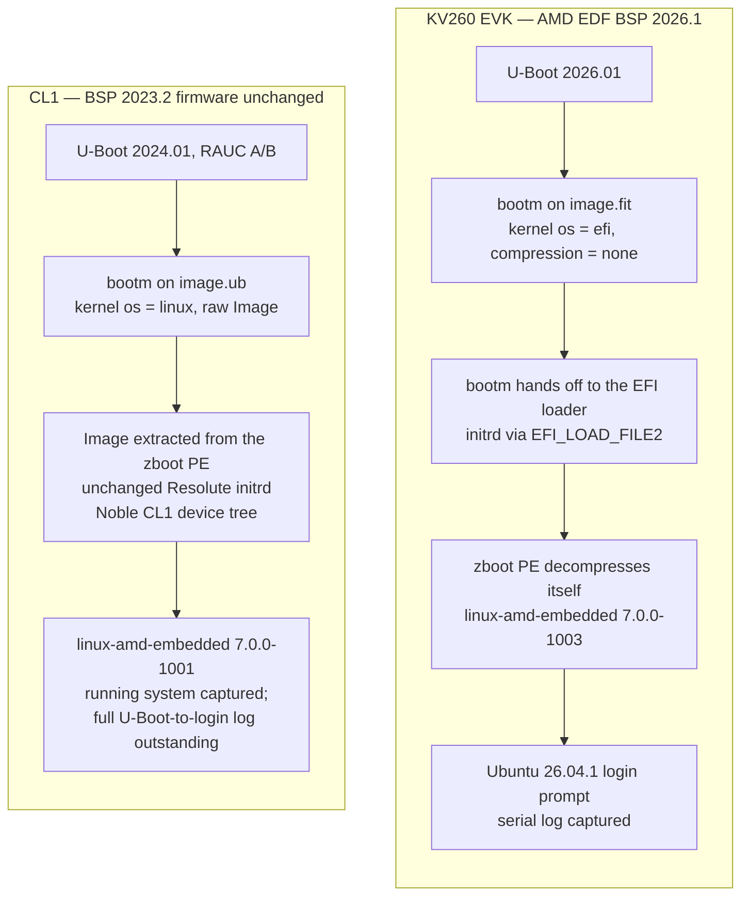

# Early-access Ubuntu 26.04 (Resolute) for AMD Kria SOM — bring-up status

12 November 2026. Prepared for management review. Evidence is in
[`evidence/`](evidence/README.md); claims without a complete log are marked
as reported by the developer.

## Outcome

Ubuntu 26.04 (Resolute) now boots as an early-access arm64 server image on
both the AMD KV260 EVK and the Cortical Labs CL1. There is no official
Resolute server image for Kria. This image was produced from the PE team's
existing work (Canonical OEM project "limerick"), using the default
`linux-amd-embedded` distro kernel — it was not recompiled from source —
and without replacing the CL1 board's BSP 2023.2 boot firmware or its RAUC
A/B layout.

The engineering result is that one distro kernel works on two firmware
generations that cannot share a FIT format. On the KV260, U-Boot 2026.01
loads the kernel's EFI zboot PE from a FIT labelled `os = "efi"` and hands
it to the EFI loader. On the CL1, whose U-Boot 2024.01 cannot do that, a
host script extracts the raw arm64 `Image` from the same kind of PE and
packs it into a classic FIT (`os = "linux"`) that `bootm` can load. The
image build itself is repeatable: a small, Signed-off-by patch to the
image definition makes flash-kernel emit the correct KV260 FIT, and a host
script reproduces the CL1 FIT whenever the kernel or initrd changes.

| Board | Boot firmware | Kernel demonstrated | Result |
|---|---|---|---|
| KV260 EVK (SOM `SMK-K26-XCL2G-ED` rev 1, carrier `SCK-KV-G` rev 1) | AMD EDF BSP 2026.1, U-Boot 2026.01 (xilinx-v2026.1) | `7.0.0-1003-amd-embedded` (`7.0.0-1003.3`), 12 Nov 2026 patched image | **Boots to a login prompt.** Full serial log. ([log](evidence/2026-11-12-kv260-patched-image-boot.log), [result](evidence/2026-11-12-kv260-patched-image-result.md)) |
| Cortical Labs CL1 (K26 SOM on a Cortical Labs carrier, serial 2507-30) | Existing BSP 2023.2 firmware, U-Boot 2024.01, RAUC A/B on eMMC — **not replaced** | `7.0.0-1001-amd-embedded`, 29 Oct 2026 classic FIT | **Reported by the developer as booting.** A complete U-Boot-to-login serial log has not been captured. A running-system capture shows Ubuntu 26.04.1, the CL1 hostname, RAUC slot A, and dmesg for eMMC, NVMe and USB. ([runtime log](evidence/cl1-resolute_logs.txt), [developer note](evidence/cl1-developer-note-booting_resolute.logs)) |

The two boards were demonstrated with different `linux-amd-embedded`
package versions: KV260 on the 12 November image (`1003`), CL1 on the
earlier 29 October image (`1001`). This report does not claim that the
12 November patched image was also booted on the CL1.

**Image build.** A cross-built classic server image,
`out/kria-server.img`, is produced with `ubuntu-image classic` from
`xlnx-image-definitions` (`kria-resolute` at `2438593`) plus
[the `.its` patch](../../patches/xlnx-image-definitions/0001-kria-resolute-mark-zboot-kernel-as-efi-in-FIT.patch)
that marks the zboot kernel as EFI. Known-good versions from the 12
November manifest: flash-kernel `3.110ubuntu2.5`,
`linux-image-7.0.0-1003-amd-embedded` `7.0.0-1003.3`,
`oem-limerick-kria-meta` `0.22`, `oem-limerick-meta` `0.18~xlnx01`.
([manifest](evidence/2026-11-12-patched-manifest-versions.txt),
[FIT listing](evidence/2026-11-12-patched-image.fit.dumpimage-l.txt),
[change `refine-image-build-spec`](../../openspec/changes/refine-image-build-spec/proposal.md))

## Goal and obstacles

The goal is an early-access Ubuntu 26.04 arm64 server image that boots on
AMD Kria SOM boards, including the Cortical Labs CL1, so that work can
move forward without waiting for an official Resolute Kria image. The
baseline is set out in the project's OpenSpec
[`image-build`](../../openspec/specs/image-build/spec.md),
[`boot-chain`](../../openspec/specs/boot-chain/spec.md),
[`kernel-packaging`](../../openspec/specs/kernel-packaging/spec.md),
[`secure-boot`](../../openspec/specs/secure-boot/spec.md) and
[`cl1-board-bringup`](../../openspec/specs/cl1-board-bringup/spec.md)
specs, and is refined by the changes cited below.

Two firmware facts shape the whole activity.

1. The Resolute kernel (`linux-amd-embedded`) is an EFI zboot PE: an EFI
   stub wrapping a zstd-compressed arm64 `Image`. Booting that PE from a
   FIT needs the `bootm` → `bootefi` path, which is in upstream U-Boot
   from v2025.07 and in AMD EDF BSP from 2026.1. The KV260 has that
   firmware. The CL1 does not.
2. The CL1 runs BSP 2023.2 / U-Boot 2024.01, with a RAUC A/B scheme on
   eMMC. Replacing that U-Boot is not a small change and was left out of
   scope. The default Resolute kernel still had to be used; it was not
   to be recompiled from source.

A third, narrower issue appeared in the KV260 image itself. flash-kernel
was labelling the zboot PE as `os = "linux"` / `compression = "gzip"`.
U-Boot then tried to gunzip a PE and failed with `Bad gzipped data`.
That is a two-line FIT metadata error, not a kernel problem, and it is
what the image-build patch corrects.

## Building the Resolute image

This work is the completed OpenSpec change
[`refine-image-build-spec`](../../openspec/changes/refine-image-build-spec/proposal.md)
on branch `resolute-image-build` (tip `56f1e32`). The procedure is a
cross-build on an x86 host:

1. Check out `xlnx-image-definitions` branch `kria-resolute` at `2438593`.
2. Apply
   [`0001-kria-resolute-mark-zboot-kernel-as-efi-in-FIT.patch`](../../patches/xlnx-image-definitions/0001-kria-resolute-mark-zboot-kernel-as-efi-in-FIT.patch)
   with `git am` ([how to apply and roll back](../../patches/xlnx-image-definitions/README.md)).
3. Run `sudo ubuntu-image classic --debug -w work -O out classic/resolute/ubuntu-server-kria.yaml`.
4. Run `sudo bash hooks/kria/classic/10-flash-kernel-fitimage out` — the
   `out` argument is required; without it the hook exits and does not
   move the FIT.

The image installs `linux-amd-embedded`, `flash-kernel` and the OEM meta
packages from three PPAs, each with `keep-enabled: false`:
`ubuntu-xilinx/default`, `kkaniewski/linux-amd-embedded`, and
`sinan-k/xlnx-flash-kernel`. The private limerick-team PPAs are CI-only
and are not needed for a local build.

The only change in the image-definition tree is in
`classic/resolute/10-run-flash-kernel.sh`. Just before flash-kernel runs
in the chroot, the script relabels the `kernel-1` node of
`/usr/share/flash-kernel/its/image-kria.its` from `os = "linux"` /
`compression = "gzip"` to `os = "efi"` / `compression = "none"`. It
skips the edit if the node is already correct, and fails the build if
the edit does not take. flash-kernel then writes a correct `image.fit`
directly. The kernel payload itself is untouched: it remains the PE from
the distro package
([payload check](evidence/2026-11-12-patched-fit-payload-check.txt)).

The 12 November build matches the expected disk layout: MBR, a 1 GiB
FAT32 boot partition (`system-boot`, bootable, starting at sector 2048)
and an ext4 `writable` root
([`sfdisk`](evidence/2026-11-12-patched-kria-server.img.sfdisk.txt)).
`dumpimage -l` on that image's FIT reports `kernel-1` as
`OS: EFI Firmware`, uncompressed, sha1
`543e28113c53cecff1864c7c8499e74d1855dc25`
([listing](evidence/2026-11-12-patched-image.fit.dumpimage-l.txt)).

## Booting on the KV260 EVK

On BSP 2026.1 firmware, U-Boot 2026.01 runs `bootm` on `image.fit`.
Because the kernel node is `os = "efi"` and `compression = "none"`,
`bootm` hands the PE, the initrd and the selected device tree to the EFI
loader (`bootm` → `bootefi`; U-Boot is built with `CONFIG_BOOTM_EFI=y`).
The zboot PE then decompresses itself. This is the path required by
[`boot-chain`](../../openspec/specs/boot-chain/spec.md).

The 12 November patched image was written to a microSD card and booted
on a KV260 (carrier `SCK-KV-G` rev 1) with that firmware. The
[unedited serial log](evidence/2026-11-12-kv260-patched-image-boot.log)
shows:

- U-Boot 2026.01, board identity `ZynqMP KV260 revB`
- the boot script selecting `#conf-smk-k26-revA-sck-kv-g-revB`
- `kernel-1` as `OS: EFI Firmware`, uncompressed
- `## Transferring control to EFI`
- `Linux version 7.0.0-1003-amd-embedded` (`#3-Ubuntu`,
  `7.0.0-1003.3-amd-embedded`)
- `efi: EFI v2.11 by Das U-Boot`
- `/` mounted from `LABEL=writable` and `/boot/firmware` from
  `LABEL=system-boot`
- `Ubuntu 26.04.1 LTS kria ttyPS1` and a `kria login:` prompt

The first login requires a password change (cloud-init `chpasswd:
expire: true`). Early attempts in that log failed with `Authentication
token manipulation error` when the current password was rejected or the
new passwords did not match. That is expected first-boot behaviour, not
an image fault. The log contains password *prompts* only, not password
values.

### Recovery path for images built without the patch

Images built before the `.its` patch can be recovered without a rebuild.
The documented procedure is to loop-mount partition 1 and run:

```
fdtput -t s image.fit /images/kernel-1 os efi
fdtput -t s image.fit /images/kernel-1 compression none
```

That changes only FIT properties, not the kernel payload, and the kernel
hash still verifies. Host-side checks on the 19 October FIT that was
relabelled this way all passed, and the file is byte-identical to the
FIT the developer booted.
[The result](evidence/2026-11-12-kv260-recovery-fdtput-result.md)
records this as a pass, and states that a login prompt was observed by
the developer; no serial log of that recovery boot was kept.

The recovery is not a substitute for the build-time patch. An unpatched
root filesystem still ships the stock `image-kria.its`, so a later
on-device flash-kernel run can write a `gzip`/`linux` FIT again. The
durable fix is for flash-kernel itself to emit `efi`/`none` for zboot PE
kernels (see [Next steps](#next-steps)).

## Booting on the Cortical Labs CL1

CL1 firmware is left as it is: BSP 2023.2, U-Boot 2024.01, RAUC A/B on
eMMC
([`cl1-board-bringup`](../../openspec/specs/cl1-board-bringup/spec.md)).
That U-Boot cannot boot the Resolute PE from a FIT. A 29 October attempt
to do so — a FIT whose kernel was still `OS: EFI Firmware` — reached
`Loading Kernel Image` and then a Synchronous Abort
([failed log](evidence/cl1-failed-efi-fit-boot.log)).
That is the behaviour
[`boot-chain`](../../openspec/specs/boot-chain/spec.md)
already describes, and it is why the CL1 path is different.

The working FIT is a classic image (`image.ub`) whose kernel node is
`os = "linux"`, `compression = "none"`, load and entry `0x00200000`, and
holds the *raw* arm64 `Image` extracted from the zboot PE (72,941,568
bytes, sha1 `93dd62437a5c3beb300af5d7d9d0fa75a08fb58f`). The ramdisk is
the Resolute initrd, unchanged (sha1
`f45f21710e268206b2032f1f605290534ddab9fc`). The device tree is the
Cortical Labs blob from the Ubuntu Noble FIT delivered by the earlier RP
work on this board (load `0x44000000`). The FIT source is
[`evidence/image-cortlab.its`](evidence/image-cortlab.its)
(`os = "linux"` throughout);
[`dumpimage -l`](evidence/cl1-image.ub.dumpimage-l.txt)
of the 29 October FIT confirms the nodes above
([note on provenance](evidence/cl1-fit-note.txt)).

The Resolute root filesystem is written to one of the two eMMC root
slots. The FIT and an updated U-Boot environment (bootargs) are copied
to `/boot/firmware` on that slot. Existing `boot.scr` loads `image.ub`
at `0x12000000` and runs `bootm`.

That assembly is now a host command, not a one-off. Branch
`script-cl1-fit-image-build` at `83713fb` adds `scripts/build-cl1-fit.sh`
and `fit/image-cortlab.its`. The script takes a Resolute FIT and the
Cortical Labs DTB, extracts the zstd zboot payload to a raw `Image`,
leaves the ramdisk and the inputs unchanged, and runs `mkimage`. It
refuses to overwrite an existing `image.ub`. Inspect the script with:

```
git show script-cl1-fit-image-build:scripts/build-cl1-fit.sh
```

That branch is not merged here; this report cites it only. A 12 November
run of the script reproduced the 29 October FIT payload hashes exactly,
differing only in the Created timestamp
([note](evidence/cl1-fit-note.txt)).

**Boot result — reported by the developer.** A complete serial capture
from U-Boot 2024.01 through FIT load and a login prompt has not been
placed in this repo (task 2.1 is still open). What is on disk, from 29
October, is:

- A running-system session on the board,
  [`evidence/cl1-resolute_logs.txt`](evidence/cl1-resolute_logs.txt):
  `PRETTY_NAME="Ubuntu 26.04.1 LTS"`, `VERSION="26.04.1 LTS (Resolute
  Raccoon)"`, kernel command line with `systemd.hostname=CL1-2507-30`,
  `rauc.slot=A` and `console=ttyPS0,115200`, and `dmesg` excerpts
  showing eMMC (`mmcblk0` 14.8 GiB, partitions p1–p3), NVMe (`nvme0n1`)
  and two xHCI USB controllers (a SanDisk device on `usb 1-1`). The
  kernel is identified as `7.0.0-1001-amd-embedded`. The prompt is a
  root shell; this is not a U-Boot-to-login log, and it has no ethernet
  dmesg and no `lsusb` / `ethtool` / `lsblk` command output.
- The developer's note,
  [`evidence/cl1-developer-note-booting_resolute.logs`](evidence/cl1-developer-note-booting_resolute.logs),
  that the image "seems to boot fine" and that eMMC, ethernet, NVMe,
  USB Type-A and USB Type-C enumerated.

Until a full boot log is captured, "CL1 boots Resolute" and the ethernet
result are reported by the developer, with the partial evidence above.

## Boot flows compared

The same class of distro kernel, two firmware paths. The KV260 path is
fully logged; the CL1 path is as designed and as assembled, with the
running-system evidence above.



## Results

| Check | Evidence | Result |
|---|---|---|
| Patched Resolute image builds with `kernel-1` `os = efi`, `compression = none` | [FIT listing](evidence/2026-11-12-patched-image.fit.dumpimage-l.txt), [payload check](evidence/2026-11-12-patched-fit-payload-check.txt), [manifest](evidence/2026-11-12-patched-manifest-versions.txt), [patch](../../patches/xlnx-image-definitions/0001-kria-resolute-mark-zboot-kernel-as-efi-in-FIT.patch) | Pass |
| KV260 boots that image to a login prompt, via `bootm` → EFI | [serial log](evidence/2026-11-12-kv260-patched-image-boot.log), [result](evidence/2026-11-12-kv260-patched-image-result.md) | Pass |
| Disk layout: MBR, `system-boot` + `writable` | [`sfdisk`](evidence/2026-11-12-patched-kria-server.img.sfdisk.txt), `findmnt` in the result | Pass |
| Recovery: `fdtput` relabel of an unpatched FIT | [recovery result](evidence/2026-11-12-kv260-recovery-fdtput-result.md) | Pass on host-side checks. Login reported by the developer; no serial log. |
| CL1 classic FIT holds a raw arm64 `Image`, `os = linux`, unchanged ramdisk, Noble CL1 DTB | [dumpimage](evidence/cl1-image.ub.dumpimage-l.txt), [`.its`](evidence/image-cortlab.its), [note](evidence/cl1-fit-note.txt) | Pass (FIT contents) |
| Host script reproduces that FIT | `git show script-cl1-fit-image-build:scripts/build-cl1-fit.sh` at `83713fb`; [12 Nov listing](evidence/cl1-fit-note.txt) | Pass (payload hashes match the 29 Oct FIT) |
| An `os = efi` FIT is not bootable on CL1 U-Boot 2024.01 | [failed log](evidence/cl1-failed-efi-fit-boot.log) | Confirmed (Synchronous Abort) |
| CL1 boots Resolute to a running system | [runtime log](evidence/cl1-resolute_logs.txt), [developer note](evidence/cl1-developer-note-booting_resolute.logs) | **Reported by the developer.** No complete U-Boot-to-login serial log. |
| CL1 peripherals: USB Type-A and Type-C, NVMe, eMMC | [dmesg in the runtime log](evidence/cl1-resolute_logs.txt) | Partial: devices appear in dmesg. Formal `lsusb` / `lsblk` not captured. |
| CL1 1G ethernet | [developer note](evidence/cl1-developer-note-booting_resolute.logs) only | **Reported by the developer.** No dmesg or `ethtool` capture. |
| KV260 UEFI Secure Boot temporarily off | [secure-boot excerpt](evidence/secure-boot.txt) | Confirmed: `# CONFIG_EFI_SECURE_BOOT is not set` (meta-mok `2015820`); boot log `Secure Boot: not authenticated, not encrypted`. |

## Other deliverables

- **OpenSpec in this repo.** Baseline specs for the image, boot chain,
  kernel packaging, Secure Boot and CL1 bring-up; a completed
  [`refine-image-build-spec`](../../openspec/changes/refine-image-build-spec/proposal.md)
  change with evidence; the CL1 FIT script as change
  `script-cl1-fit-image-build` on its own branch; and this status
  report, which is itself an OpenSpec change
  (`add-bringup-status-report`).
- **A patch, not a manual edit.** The FIT correction is a git patch with
  an explanatory message and a Signed-off-by trailer, kept under
  [`patches/xlnx-image-definitions/`](../../patches/xlnx-image-definitions/README.md).
- **A repeatable CL1 FIT build.** `scripts/build-cl1-fit.sh` on
  `script-cl1-fit-image-build` (`83713fb`), cited rather than merged.
- **A KV260 build guide**, outside this repo, at
  `kria_images/KV260-ubuntu-26.04-build.md`. Discrepancies between that
  guide and the actual procedure (notably the FIT-hook `out` argument,
  and the move from a manual `fdtput` to the build-time patch) are
  recorded in the [patch README](../../patches/xlnx-image-definitions/README.md).
- **Image-size work** is identified as a follow-up
  (`slim-server-image`). It has not been applied, and this report does
  not quote size figures that were not re-measured against the 12
  November image.

## Risks and open items

- **UEFI Secure Boot is disabled on the KV260 firmware used for this
  bring-up.** The distro kernel is not signed with a key in `db`, and
  the preseeded EFI variables cannot be cleared at the U-Boot prompt.
  meta-mok commit `2015820` turns `CONFIG_EFI_SECURE_BOOT` off for
  early access. This is temporary and is already described in
  [`secure-boot`](../../openspec/specs/secure-boot/spec.md).
- **The flash-kernel template is still wrong upstream.** The
  image-definition patch fixes the FIT at build time, but a later
  flash-kernel run on the board can write an unbootable FIT again.
  The `fdtput` recovery is documented. The lasting fix belongs in the
  `sinan-k/xlnx-flash-kernel` PPA and then in Debian/Ubuntu flash-kernel.
- **CL1 evidence is incomplete.** There is no U-Boot-to-login serial
  log, and no formal `lsusb` / `ip` / `ethtool` / `lsblk` output.
  Ethernet is only in the developer's note. Those captures are still
  open as manual tasks.
- **The two boards were shown with different kernel package versions**
  (`1003` on KV260, `1001` on CL1). A CL1 boot of the 12 November
  patched image has not been recorded.
- **On-device flash-kernel and Secure Boot are the two remaining
  workarounds** that should not ship in a product image.

## Next steps

Each item is a candidate OpenSpec change. None of them is started by
this report.

| Candidate change | Why, and what is needed |
|---|---|
| `fix-flash-kernel-zboot-its` | The durable fix: flash-kernel emits `os = "efi"` / `compression = "none"` for zboot PE kernels, so the image-definition patch becomes a no-op and on-device upgrades stay bootable. Needs work with Sinan in `sinan-k/xlnx-flash-kernel`, then upstream. |
| `slim-server-image` | Reduce the early-access image's footprint once a size analysis has been agreed. Needs a decision to proceed; no slimming has been applied. |
| `re-enable-uefi-secure-boot` | Sign the Resolute kernel or enrol its hash in `db`, then revert meta-mok `2015820`, so KV260 boots with Secure Boot enforced. |
| Land `script-cl1-fit-image-build` on main | The script and `.its` already exist at `83713fb`. Merging that branch (or cherry-picking the files) would put the repeatable CL1 FIT build on the same history as the image-build work. The change text on main is an earlier planning-only copy and should be reconciled with the script-branch wording. |
| Complete CL1 boot and peripheral evidence | If a management or customer review needs a U-Boot-to-login serial log and formal peripheral commands, those are tasks 2.1 and 2.2 of this change and can be done on the current board without further engineering. |

## Acknowledgements

**Sinan** (Launchpad `sinan-k`) maintains the patched flash-kernel in the
PPA `sinan-k/xlnx-flash-kernel`. The Resolute Kria image uses that
package (`3.110ubuntu2.5` in the 12 November manifest): it knows the
Kria machines and ships `image-kria.its`. The remaining FIT-label fix
for zboot kernels is the natural next step in that same line of work.

**The RP team** delivered the earlier Ubuntu Noble bring-up on the
Cortical Labs CL1. The CL1 Resolute FIT reuses the Cortical Labs device
tree from that Noble FIT; this work did not have to reverse-engineer
the carrier.
